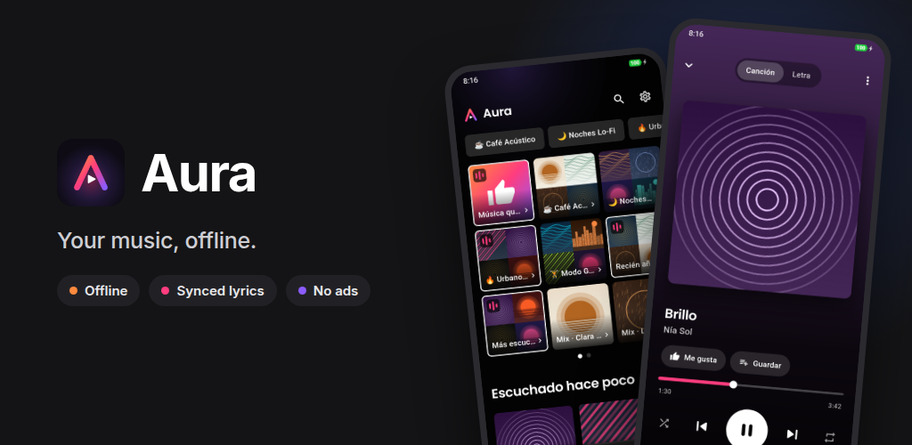
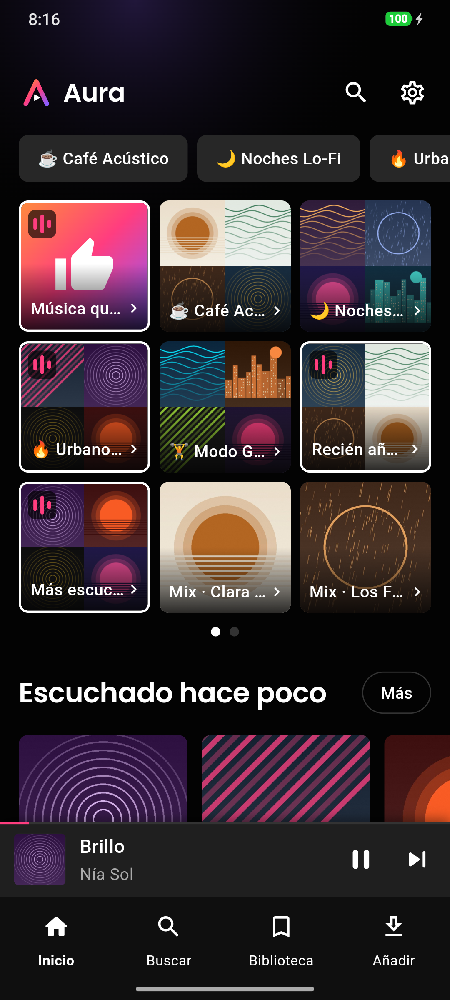
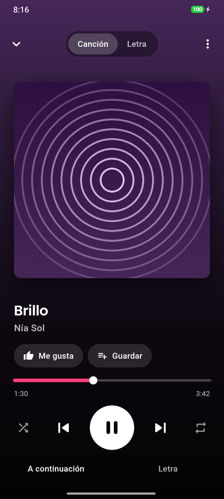
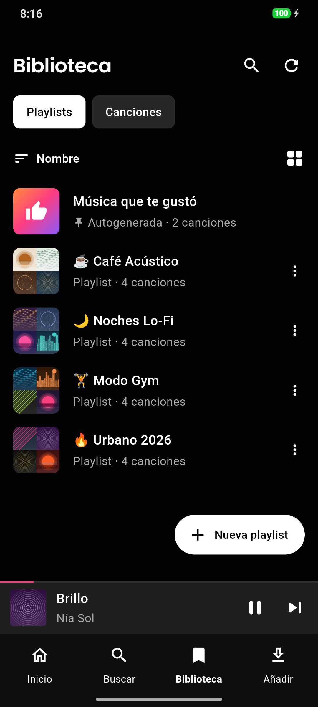
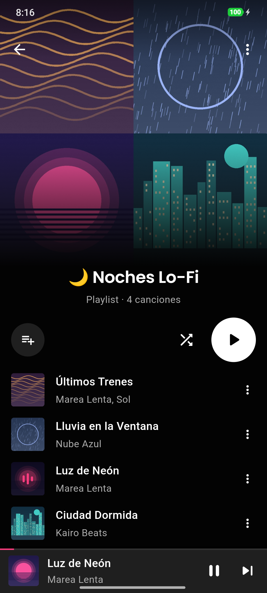
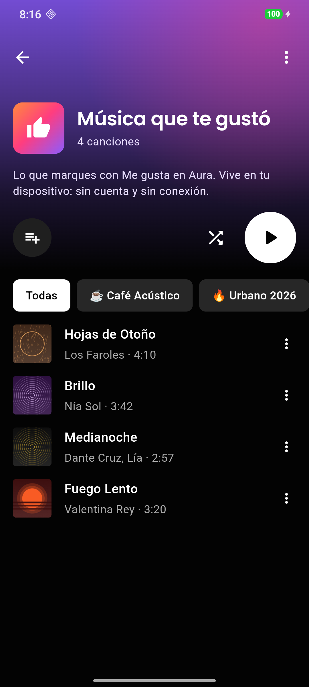
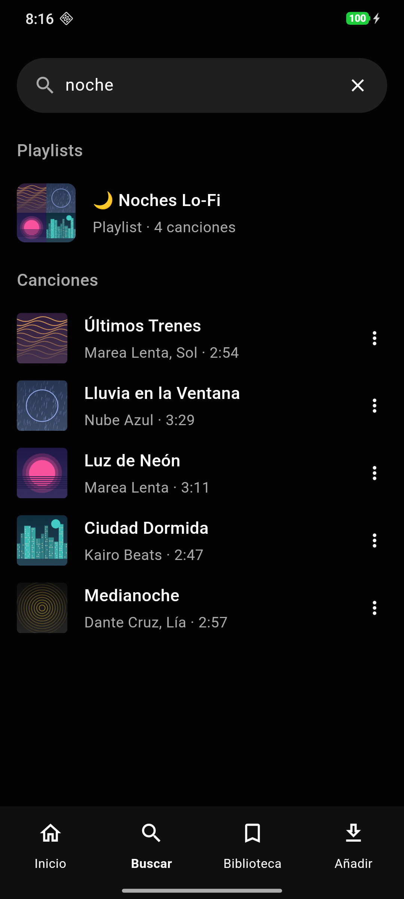
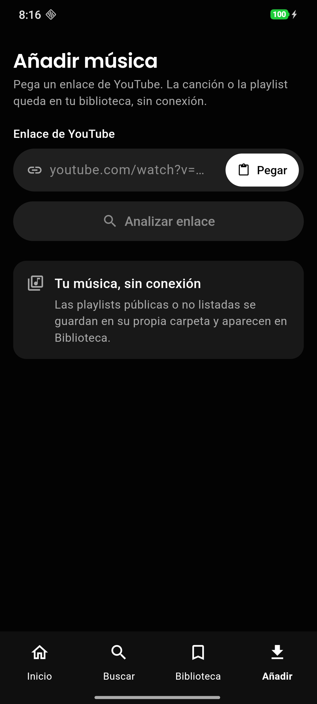
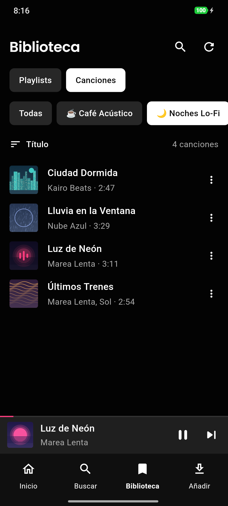

<div align="center">


<h2>Aura Music</h2>

<h4>Reproductor de música offline por carpetas para Android</h4>

<p>
  <a href="https://github.com/y0ner/aura_music/releases/latest">
    
  </a>
</p>

<p>
  <a href="https://github.com/y0ner/aura_music/releases/latest">
    
  </a>
  <a href="LICENSE">
    
  </a>
  
  
</p>

<p>
  
  
  
</p>

[English](README.md) &bull; Español

[Capturas](#capturas) &bull; [Descripción](#descripción) &bull; [Funciones](#funciones) &bull; [Descarga](#descarga-e-instalación) &bull; [Privacidad](#privacidad) &bull; [Compilar](#compilar-desde-el-código-fuente) &bull; [Stack técnico](#stack-técnico-y-arquitectura) &bull; [Contribuir](#contribuir) &bull; [Licencia](#licencia)

[Sitio web](https://aura-musica.vercel.app) &bull; [Versiones](https://github.com/y0ner/aura_music/releases) &bull; [Changelog](CHANGELOG.md)

Versión actual: **1.0.0** — [notas de la versión](CHANGELOG.md)

</div>

---

## Capturas

<p align="center">
  
</p>

<table>
  <tr>
    <td align="center">
      
      <br /><sub>1. Inicio</sub>
    </td>
    <td align="center">
      
      <br /><sub>2. Reproductor</sub>
    </td>
    <td align="center">
      
      <br /><sub>3. Biblioteca</sub>
    </td>
    <td align="center">
      
      <br /><sub>4. Playlist</sub>
    </td>
  </tr>
  <tr>
    <td align="center">
      
      <br /><sub>5. Música que te gustó</sub>
    </td>
    <td align="center">
      
      <br /><sub>6. Buscar</sub>
    </td>
    <td align="center">
      
      <br /><sub>7. Añadir desde YouTube</sub>
    </td>
    <td align="center">
      
      <br /><sub>8. Canciones con filtros</sub>
    </td>
  </tr>
</table>

---

## Descripción

**Aura Music** (`com.yoner.auramusic.aura_music`) es un reproductor de música offline para Android y escritorio Linux con una interfaz oscura OLED (`#030303`) inspirada en YouTube Music y construida bajo su propia identidad visual **A·Play**.

Tu sistema de archivos es tu biblioteca: cada subcarpeta dentro de `Music/AuraMusic` en Android (`~/Music/AuraMusic` en Linux) se convierte automáticamente en una playlist, incluso con emojis en el nombre. Puedes crear o gestionar carpetas desde la app y añadir canciones o playlists pegando enlaces de YouTube, manteniendo todo en tu dispositivo sin cuentas, sin anuncios y sin rastreo.

---

## Funciones

### Biblioteca

- **Playlists por carpetas:** Cada subcarpeta dentro de `Music/AuraMusic` (`~/Music/AuraMusic` en Linux) es una playlist, con soporte completo de emojis en el nombre.
- **Gestión de carpetas:** Crea nuevas playlists (carpetas) desde la app, elige otra carpeta raíz de música y vuelve a escanear la biblioteca cuando quieras.
- **Vistas de playlists y canciones:** Alterna entre lista o cuadrícula, ordena playlists por nombre o cantidad de canciones y explora la vista *Canciones* con filtros reales por carpeta y orden por título, artista o duración.
- **Detalle de playlist:** Collage 2 × 2 de carátulas a todo el ancho, reproducir, aleatorio, añadir a la fila y eliminar la carpeta.
- **«Música que te gustó»:** Los Me gusta se guardan localmente en el dispositivo, sobreviven al reinicio de la app e incluyen filtros por carpeta.
- **Artista desde el nombre y reparación de etiquetas:** Extrae `Artista - Título (Official Video) ft. X` como artista (`Artista, X`) y título (`Título`) cuando el archivo no trae etiquetas, repara etiquetas ID3 UTF-16BE corruptas y evita mostrar «Artista desconocido» en la interfaz.

### Inicio y búsqueda

- **Cuadrícula 3 × 3 de accesos rápidos:** Páginas deslizables (hasta 3) con «Música que te gustó», playlists, «Recién añadidas», «Más escuchadas» y mixes por artista, destacando la playlist que está sonando.
- **Inicio dinámico:** Chips de acceso rápido por playlist y fila horizontal «Escuchado hace poco» basada en tu historial local.
- **Búsqueda instantánea:** Busca en canciones, artistas, carpetas y playlists sin distinguir tildes ni mayúsculas, con hasta 10 búsquedas recientes guardadas y accesos directos a las listas automáticas.

### Reproductor y letras

- **Reproductor completo:** Fondo degradado tomado del color de la carátula, botones *Me gusta* y *Guardar* en playlist, aleatorio, repetir y repetir una, barra de progreso interactiva y fila *A continuación* (reproducir a continuación, agregar a la fila, quitar), junto a un mini reproductor fijo sobre la barra inferior.
- **Letras sincronizadas:** Lee archivos `.lrc` junto al audio; si no hay, consulta LRCLIB (`lrclib.net`, sin cuenta), prioriza la versión sincronizada y la guarda en caché para usarla sin conexión. Resalta el verso activo y permite saltar a ese punto al tocar un verso.

### Descargas desde YouTube

- **Análisis y descarga:** Pega el enlace de una canción o de una playlist pública o no listada de YouTube, revisa la vista previa, elige la carpeta destino y descarga el audio (`.m4a`) a la biblioteca.
- **Cola de descargas FIFO:** Progreso en tiempo real por pista y playlist, cancelar descarga activa, reintentar fallidas y limpiar las terminadas.
- **Carátulas limpias y precarga de letras:** Recorta automáticamente las franjas negras de las miniaturas 4:3 de YouTube al guardar carátulas y precarga la letra en segundo plano.

### Reproducción en segundo plano

- **MediaSession en Android:** Sigue sonando en segundo plano con notificación multimedia (carátula, barra de progreso, repetir y Me gusta) y soporte para controles de auriculares.
- **MPRIS en Linux de escritorio:** Reproduce audio mediante GStreamer (`gst-play-1.0`) e integra controles `org.mpris.MediaPlayer2` con el widget de medios del escritorio.
- **Logo propio «A·Play»:** Ícono adaptativo y temático en Android 13+, e ícono monocromo para notificaciones.

---

## Descarga e instalación

- **Requisitos:** Android 7.0 o superior (`minSdk 24`), arquitectura `arm64` (~22 MB).
- **Última versión:** Descarga [`aura-music-v1.0.0-arm64.apk`](https://github.com/y0ner/aura_music/releases/latest/download/aura-music-v1.0.0-arm64.apk) desde la página de [Versiones](https://github.com/y0ner/aura_music/releases/latest).

1. Descarga el archivo `.apk` de la última versión publicada en GitHub.
2. Permite la instalación de apps desde tu navegador o gestor de archivos si Android lo solicita.
3. Abre **Aura Music** y concede el permiso de audio para escanear `Music/AuraMusic` (o elige otra carpeta desde Configuración).

### Certificado de firma de la APK

Puedes verificar la integridad de la APK oficial comparando el certificado de firma (`CN=Aura Music, OU=y0ner, C=CO`) con `apksigner` o `keytool`:

```text
SHA-256: A7:79:B5:5E:1E:05:3B:A6:13:A0:A2:24:A6:18:EF:61:9D:BD:A0:62:76:26:5B:3A:CB:88:78:54:0E:F4:39:D8
```

> [!NOTE]
> **Aviso:** Aura no está afiliada a YouTube ni a Google. Descargar contenido de YouTube puede ir contra sus Términos de servicio: el usuario es responsable de descargar únicamente contenido que tenga derecho a guardar.

---

## Privacidad

- **Sin cuenta, sin anuncios, sin rastreo ni analíticas.** Aura Music funciona sin conexión con tu música local.
- **Datos solo en tu dispositivo:** Favoritos, historial de reproducción, búsquedas recientes, carátulas recortadas y letras en caché se guardan localmente en el dispositivo.
- **Red bajo demanda:** La app solo se conecta a internet cuando pegas un enlace de YouTube para descargarlo o cuando busca una letra faltante en LRCLIB.

### Permisos en Android

| Permiso | Para qué se usa |
| :--- | :--- |
| `INTERNET` | Descargar audio desde los enlaces de YouTube que pegue el usuario y consultar letras en LRCLIB. |
| `READ_MEDIA_AUDIO` / `READ_EXTERNAL_STORAGE` | Leer las carpetas y archivos de música locales. |
| `WRITE_EXTERNAL_STORAGE` | Guardar descargas en versiones antiguas de Android. |
| `MANAGE_EXTERNAL_STORAGE` | Declarado para poder usar carpetas fuera de `Music/`; **no** se solicita automáticamente. |
| `FOREGROUND_SERVICE` / `FOREGROUND_SERVICE_MEDIA_PLAYBACK` / `WAKE_LOCK` | Mantener la reproducción activa en segundo plano. |
| `POST_NOTIFICATIONS` | Mostrar la notificación multimedia de reproducción en Android 13+. |

---

## Compilar desde el código fuente

### Requisitos previos

- **Flutter 3.47+** / **Dart 3.13+**
- **Android SDK** (para compilar e instalar en Android)
- **GStreamer (`gst-play-1.0`)** en Linux de escritorio (`./run.sh linux` revisa los códecs y ejecuta `tool/setup_linux_audio.sh` si faltan)

### Con `run.sh`

```bash
git clone https://github.com/y0ner/aura_music.git
cd aura_music

./run.sh linux      # Ejecutar en Linux de escritorio
./run.sh android    # Ejecutar en dispositivo Android conectado
./run.sh build-apk  # Compilar el APK release
./run.sh test       # Ejecutar las pruebas
./run.sh analyze    # Ejecutar análisis estático (flutter analyze --no-pub)
```

### Con Flutter directamente

```bash
flutter pub get
flutter build apk --release --target-platform android-arm64
```

> El build release busca `android/key.properties` para firmar con tu keystore; si no existe, Gradle firma con la clave de debug para pruebas locales.

---

## Stack técnico y arquitectura

### Stack (`pubspec.lock`)

- **Framework:** Flutter `3.47.1` / Dart `3.13.1`
- **Audio y control multimedia:** `just_audio` `0.10.6`, `audio_service` `0.18.19`, `audio_metadata_reader` `1.8.0`, `dbus` `0.7.15` (MPRIS en Linux)
- **Descargas, red e imagen:** `youtube_explode_dart` `3.1.0`, `http` `1.6.0`, `image` `4.10.1`
- **Estado, archivos y permisos:** `provider` `6.1.5+1`, `file_picker` `13.1.0`, `permission_handler` `13.0.2`, `path_provider` `2.1.6`, `intl` `0.20.3`
- **Tipografía:** Poppins SemiBold (OFL, `assets/fonts/OFL-Poppins.txt`) + Roboto

### Arquitectura

La arquitectura separa estado, almacenamiento y reproducción mediante servicios `ChangeNotifier` conectados con `provider`:

- **`MusicStorageService` (`lib/services/storage_service.dart`):** Escanea carpetas y lee etiquetas/carátulas en un `Isolate.run`, mantiene listas derivadas en caché hasta `notifyListeners` y normaliza las búsquedas sin tildes ni mayúsculas.
- **`PlayerService` (`lib/services/player_service.dart`):** Gestiona la cola, aleatorio, modos de repetición, reproducción Android (`just_audio`) y escritorio Linux (`gst-play-1.0`). Publica el avance de posición por un `ValueListenable<Duration>` independiente (`positionListenable`) para no redibujar pantallas completas.
- **`YoutubeDownloadService` (`lib/services/youtube_service.dart`):** Analiza enlaces, pagina playlists con `PlaylistFetcher`, ejecuta una cola FIFO de `DownloadJob`, recorta franjas negras de miniaturas en isolate y precarga letras.
- **`LyricsService` y `LrclibFetcher` (`lib/services/lyrics_service.dart`, `lib/services/lyrics_fetcher.dart`):** Carga primero archivos `.lrc` / `_private.lrc` locales (con coincidencia tolerante en la carpeta) y recurre a la caché o a LRCLIB cuando no existen.
- **`LibraryStateStore` (`lib/services/library_state_store.dart`):** Persiste favoritos, historial de reproducciones y búsquedas recientes mediante escrituras atómicas en `library_state.json`.
- **`AuraAudioHandler` (`lib/services/aura_audio_handler.dart`):** Conecta `PlayerService` con la `MediaSession` y la notificación de Android.
- **`AppTheme` (`lib/theme/app_theme.dart`):** Centraliza colores, tipografía, espaciados y radios de todo el diseño.

---

## Cómo se hizo

- El diseño visual nació de un prototipo navegable (archivado en `docs/rediseno/prototipo/`).
- Un agente jefe (Claude Code) redactó briefs cerrados y dividió el desarrollo en 7 tareas —entre ellas datos de biblioteca, carátulas cuadradas, logo e íconos, reproductor, biblioteca y playlists, pantalla Añadir y navegación/Inicio/Buscar— ejecutadas por agentes Gemini (CLI Antigravity `agy`), cada uno en su propio worktree y rama.
- El jefe revisó cada diff, ejecutó el análisis estático y las 128 pruebas unitarias y de widgets, e integró todo mediante pull requests.
- Las pruebas en dispositivo real se realizaron en un teléfono Android mediante `adb`.
- Una pasada específica de optimización bajó el uso de CPU con música sonando del **86 %** a **~13–24 %** (separando la posición en `ValueListenable`, cacheando listas derivadas, escaneando etiquetas en isolates, decodificando carátulas al tamaño en pantalla y eliminando avisos innecesarios por segundo a la `MediaSession`).

---

## Contribuir

Las contribuciones, reportes de errores y pull requests son bienvenidos. Consulta [CONTRIBUTING.md](CONTRIBUTING.md) antes de enviar cambios o abre un issue en [GitHub Issues](https://github.com/y0ner/aura_music/issues).

---

## Terceros

- **Paquetes de Dart y Flutter:** `just_audio`, `audio_service`, `youtube_explode_dart`, `audio_metadata_reader`, `provider`, `http`, `image`, `file_picker`, `permission_handler`, `path_provider`, `dbus`, `intl`, `cupertino_icons` y `flutter_lints`.
- **Letras:** API pública de [LRCLIB](https://lrclib.net).
- **Tipografía:** [Poppins](assets/fonts/OFL-Poppins.txt) de The Poppins Project Authors bajo licencia SIL Open Font License 1.1.

---

## Licencia

Aura Music es software libre publicado bajo la licencia **GNU General Public License v3.0 (GPLv3)**. Consulta el archivo [LICENSE](LICENSE) para ver el texto completo.
