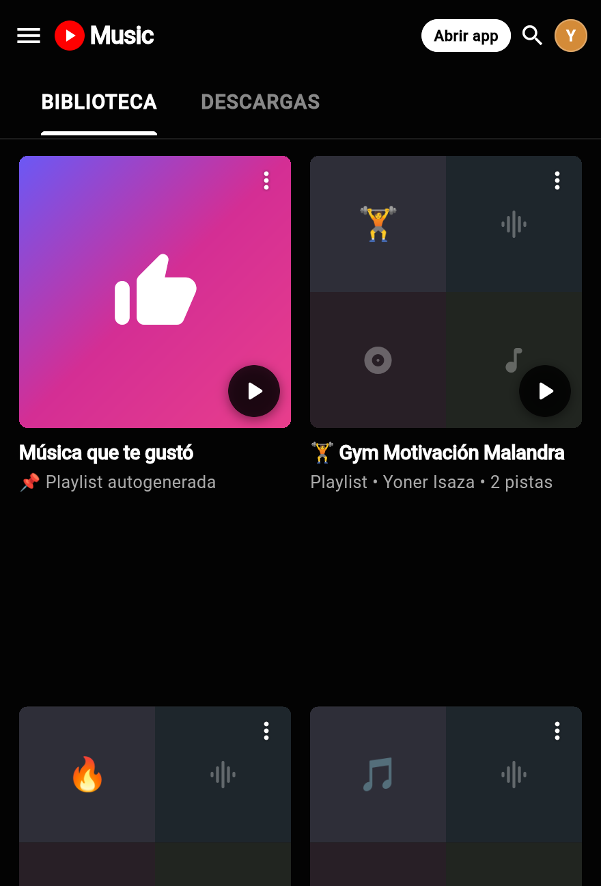
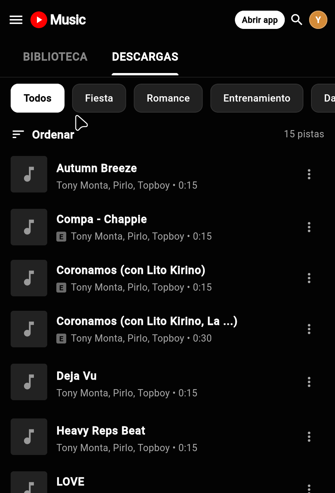
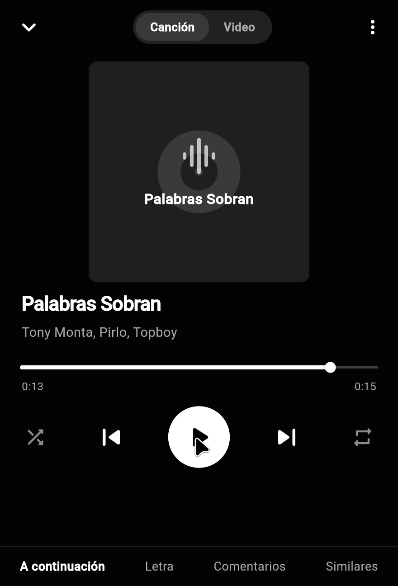

# 🎵 Aura Music — Reproductor de Música Estilo YouTube Music

Una aplicación nativa de reproducción de música desarrollada en **Flutter**, diseñada con una interfaz **100% idéntica a YouTube Music** (Dark AMOLED `#030303`), lectura automática de metadatos de audio ID3 y una mecánica inteligente basada en carpetas y subcarpetas para la gestión de playlists sin necesidad de base de datos externa ni conexión a internet.

---

## 📸 Capturas de Pantalla de la Aplicación

| Biblioteca (Playlists 2x2 + Emojis) | Descargas (Filtros + Lista de Canciones) | Reproductor Completo (Controles YT Music) |
| :---: | :---: | :---: |
|  |  |  |

---

## ✨ Características Principales

### 1. 📂 Mecánica de Carpetas y Playlists Automáticas
* **Carpeta Raíz del Sistema**:
  * **En Celular (Android)**: `/storage/emulated/0/Music/AuraMusic/`
  * **En Linux Desktop**: `~/Music/AuraMusic/`
* **Subcarpeta = Playlist Instantánea**:
  * Cualquier subcarpeta creada dentro de `AuraMusic` (por ejemplo: `🔥 Trap Latino Malandro`, `🏋️ Gym Motivación`, `🍂 Autumn Vibes`) se detecta automáticamente al iniciar o al pulsar **"Escanear"**.
  * **Soporte Total de Emojis**: Si la carpeta contiene emojis (`🔥`, `🏋️`, `❤️`, `🎧`), se renderizan en el título de la playlist.
  * **Collage de Carátulas 2x2**: La app toma automáticamente las primeras 4 canciones con carátula de la carpeta y genera una cuadrícula 2x2 idéntica a la vista de álbumes de YouTube Music.
  * **Botón Play Flotante**: Cada tarjeta de playlist incluye un botón de reproducción flotante en la esquina inferior derecha.

### 2. 💖 Tarjeta Especial *"Música que te gustó"*
* En la parte superior izquierda de la biblioteca se muestra la tarjeta de favoritos autogenerada con el característico degradado fucsia/púrpura de YouTube Music, el icono de pulgar arriba (`👍`), etiqueta `📌 Playlist autogenerada` y botón de reproducción directo.

### 3. 📥 Pestaña "DESCARGAS" (Todas las Canciones)
* Muestra la lista completa de canciones del dispositivo y carpetas.
* **Píldoras deslizables de filtro**: `Todos`, `Fiesta`, `Romance`, `Entrenamiento`, `Danza`, `Trap`.
* **Botón `≡ Ordenar`**: Ordenar por Título, Artista o Duración.
* **Insignia `[E]` (Explicit)**: Etiquetas automáticas para contenido explícito.
* Duración formateada y menú contextual de 3 puntos.

### 4. 🎛️ Mini Reproductor Inferior
* Permanece siempre visible en la parte inferior durante la reproducción.
* Miniatura de carátula, título y artista con insignia `[E]`.
* Línea de progreso en tiempo real de 2px en el borde superior.
* Botones de Play/Pausa y Siguiente canción.
* Al tocarlo, se despliega suavemente el **Reproductor Completo**.

### 5. 🎧 Reproductor Fullscreen (Vista Expandida)
* **Barra superior**: Flecha hacia abajo (`⌵`) para minimizar, selector tipo píldora `Canción | Video` y menú de opciones (`⋮`).
* **Carátula Gigante**: Cuadrada con esquinas redondeadas (`10px`) y sombra envolvente.
* **Información de la Pista**: Título en blanco grande y artistas.
* **Barra de Progreso (Scrubber)**: Deslizador blanco interactivo con tiempos transcurrido (`0:13`) y total (`0:15`).
* **Fila de Controles**:
  * Aleatorio (`🔀`)
  * Canción Anterior (`⏮`)
  * **Botón Play/Pausa Circular Blanco Gigante** con icono en color negro (`▶` / `⏸`).
  * Canción Siguiente (`⏭`)
  * Modo Repetición (`🔁` / repetir una).
* **Pestañas Inferiores**: `A continuación` (Cola interactiva), `Letra`, `Comentarios`, `Similares`.

---

## 🚀 Cómo Ejecutar y Probar la Aplicación

### En Linux Desktop:
Puedes ejecutar la aplicación directamente desde la terminal:

```bash
cd /home/yoner/Desktop/Projects/aura_music

# Ejecutar con Flutter
/home/yoner/flutter/bin/flutter run -d linux

# O ejecutar el binario precompilado
./build/linux/x64/debug/bundle/aura_music
```

### En Android (Generar APK para el Celular):
Para compilar el archivo instalable `.apk` para tu teléfono Android:

```bash
cd /home/yoner/Desktop/Projects/aura_music
/home/yoner/flutter/bin/flutter build apk --release
```
El archivo generado se ubicará en `build/app/outputs/flutter-apk/app-release.apk`.

---

## 🗂️ Estructura del Código

```text
aura_music/
├── lib/
│   ├── models/
│   │   ├── song_model.dart            # Modelo de pista, duración, metadata ID3 y carátula
│   │   └── playlist_model.dart        # Modelo de subcarpeta, conteo y collage 2x2
│   ├── services/
│   │   ├── storage_service.dart       # Gestor de carpetas, escáner y extracción de tags
│   │   └── player_service.dart        # Motor de audio, cola, shuffle, repeat y timers
│   ├── theme/
│   │   └── app_theme.dart             # Paleta YouTube Music (#030303, #212121, degradados)
│   ├── widgets/
│   │   ├── header_bar.dart            # Barra superior (Logo, Abrir app, Lupa, Avatar)
│   │   ├── collage_cover.dart         # Widget de portada cuadrícula 2x2 y Me Gusta
│   │   ├── explicit_badge.dart        # Insignia cuadrada [E]
│   │   ├── mini_player.dart           # Reproductor flotante inferior
│   │   └── fullscreen_player.dart     # Pantalla completa del reproductor con controles
│   ├── screens/
│   │   ├── home_screen.dart           # Coordinador de pestañas y gestor de carpetas
│   │   ├── library_screen.dart        # Grid de playlists (BIBLIOTECA)
│   │   ├── downloads_screen.dart      # Lista de canciones con filtros (DESCARGAS)
│   │   └── playlist_detail_screen.dart# Vista interna de cada playlist/subcarpeta
│   └── main.dart                      # Punto de entrada y configuración de tema oscuro
└── pubspec.yaml
```
