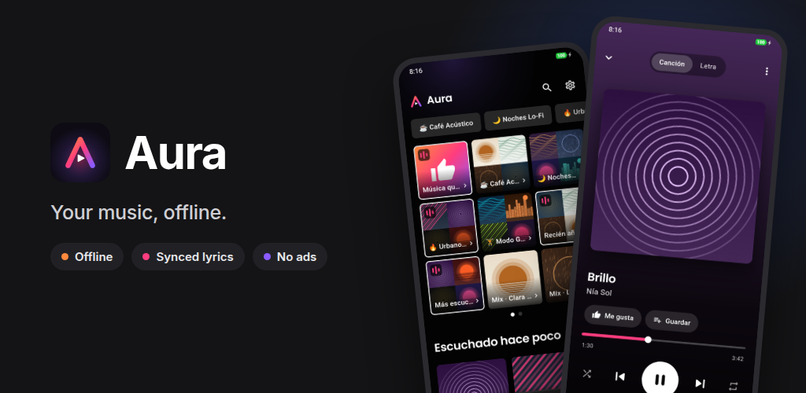
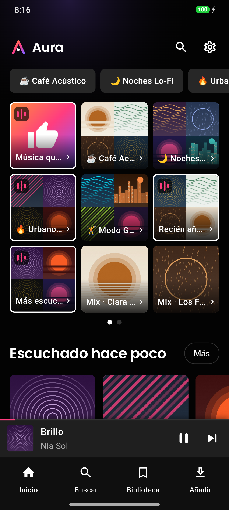
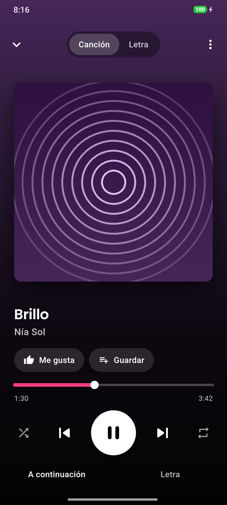
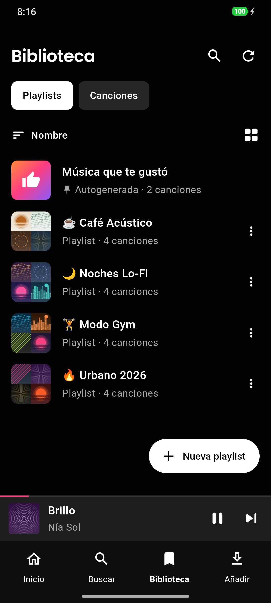
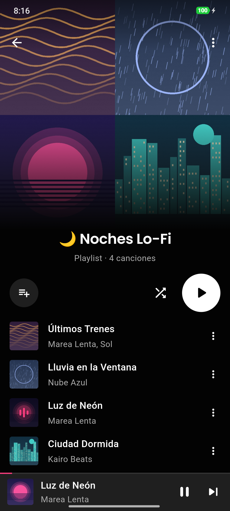
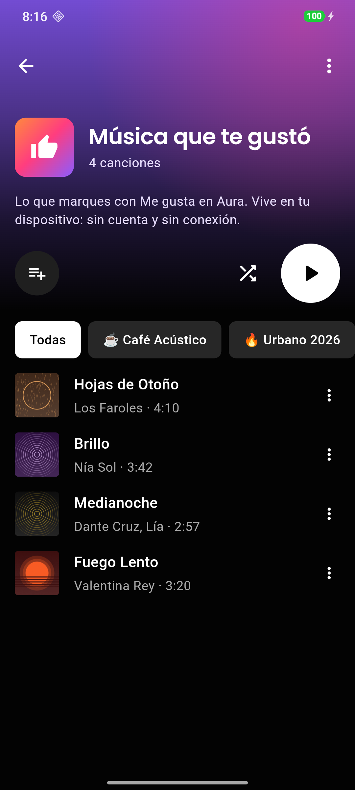
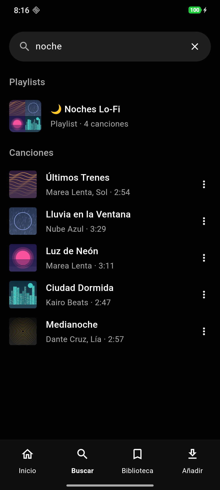
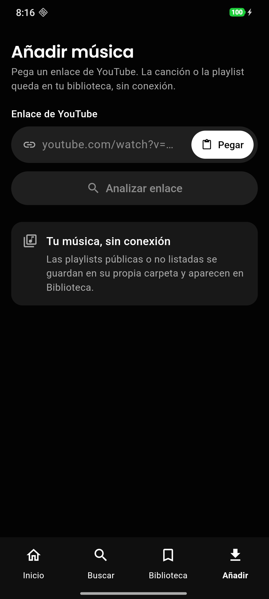
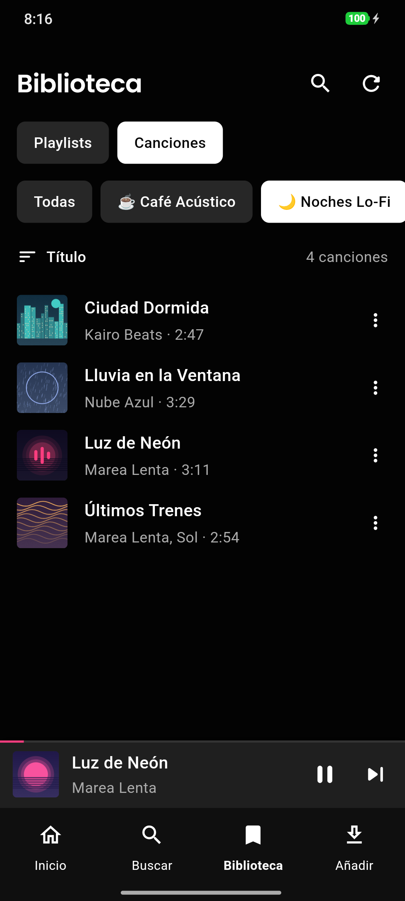

<div align="center">


<h2>Aura Music</h2>

<h4>Offline folder-based music player for Android</h4>

<p>
  <a href="https://github.com/y0ner/aura_music/releases/latest">
    
  </a>
</p>

<p>
  <a href="https://github.com/y0ner/aura_music/releases/latest">
    
  </a>
  <a href="LICENSE">
    
  </a>
  
  
</p>

<p>
  
  
  
</p>

English &bull; [Español](README.es.md)

[Screenshots](#screenshots) &bull; [Description](#description) &bull; [Features](#features) &bull; [Download](#download--installation) &bull; [Privacy](#privacy) &bull; [Building](#building-from-source) &bull; [Tech stack](#tech-stack--architecture) &bull; [Contributing](#contributing) &bull; [License](#license)

[Website](https://aura-musica.vercel.app) &bull; [Releases](https://github.com/y0ner/aura_music/releases) &bull; [Changelog](CHANGELOG.md)

Current version: **1.0.0** — [release notes](CHANGELOG.md)

</div>

---

## Screenshots

<p align="center">
  
</p>

<table>
  <tr>
    <td align="center">
      
      <br /><sub>1. Home</sub>
    </td>
    <td align="center">
      
      <br /><sub>2. Player</sub>
    </td>
    <td align="center">
      
      <br /><sub>3. Library</sub>
    </td>
    <td align="center">
      
      <br /><sub>4. Playlist</sub>
    </td>
  </tr>
  <tr>
    <td align="center">
      
      <br /><sub>5. Liked Music</sub>
    </td>
    <td align="center">
      
      <br /><sub>6. Search</sub>
    </td>
    <td align="center">
      
      <br /><sub>7. Add from YouTube</sub>
    </td>
    <td align="center">
      
      <br /><sub>8. Songs with filters</sub>
    </td>
  </tr>
</table>

---

## Description

**Aura Music** (`com.yoner.auramusic.aura_music`) is an offline music player for Android and Linux desktop with an OLED dark interface (`#030303`) inspired by YouTube Music and branded around its own **A·Play** identity.

Your filesystem is your library: every subfolder inside `Music/AuraMusic` on Android (`~/Music/AuraMusic` on Linux) becomes a playlist automatically, including folders with emojis in their names. You can manage folders directly from the app or add new tracks and playlists by pasting YouTube links—everything stays locally on your device, with no accounts, no ads, and no telemetry.

---

## Features

### Library

- **Folder-based playlists:** Every subfolder inside `Music/AuraMusic` (`~/Music/AuraMusic` on Linux) is automatically detected as a playlist, with full support for emojis in folder names.
- **Library management:** Create new playlist folders from the app, choose another root music directory, and rescan your library whenever needed.
- **Playlists & songs views:** Switch between list and grid layouts for playlists, sort playlists by name or song count, and browse all songs with real folder filter chips and sorting by title, artist, or duration.
- **Playlist detail:** Full-width 2 × 2 cover collage, play, shuffle, add to queue, and delete folder actions.
- **Liked Music:** Favorites are saved locally on the device, survive app restarts, and include folder filter chips.
- **Smart filename & tag parsing:** Extracts `Artist - Title (Official Video) ft. X` into artist (`Artist, X`) and clean title (`Title`) when audio files lack artist tags, repairs corrupted UTF-16BE ID3 tags, and hides unknown-artist placeholders from the interface.

### Home & search

- **3 × 3 quick-access grid:** Paginated cards (up to 3 pages) featuring Liked Music, folder playlists, *Recently Added*, *Most Played*, and automatic mixes by top artists, highlighting the currently playing playlist.
- **Home sections:** Quick playlist chips and a *Recently Played* horizontal strip synced with local playback history.
- **Instant search:** Search across songs, artists, folders, and playlists ignoring accents and letter case, with up to 10 saved recent searches and shortcuts to auto-generated playlists.

### Player & lyrics

- **Dynamic player:** Fullscreen player whose background gradient adapts smoothly to the dominant palette of the current track's artwork, paired with a persistent mini player above the bottom navigation bar.
- **Full playback controls:** Like, Save to playlist, shuffle, repeat / repeat one, interactive seek bar, and an *Up Next* queue sheet (play next, add to queue, remove).
- **Synchronized lyrics:** Reads local `.lrc` files beside each audio file; if none exist, queries LRCLIB (`lrclib.net`, no account required), prefers time-synced lyrics, and caches them on-device for offline use. Highlights the active line and seeks directly when tapping any verse.

### YouTube downloads

- **Link analysis & download:** Paste a YouTube song link or a public/unlisted playlist link, preview its tracks, choose a destination folder, and download `.m4a` audio straight into your library.
- **FIFO download queue:** Track live progress across songs and playlists, cancel active downloads, retry failed items, and clear finished jobs.
- **Clean artwork & lyrics prefetch:** Automatically crops black letterbox bars from 4:3 YouTube thumbnails when saving covers and prefetches lyrics in the background.

### Background playback

- **Android MediaSession:** Plays continuously in the background with a media notification displaying cover art, progress bar, repeat toggle, and like button, plus headset media key support.
- **Linux desktop MPRIS:** Desktop builds play audio via GStreamer (`gst-play-1.0`) and expose `org.mpris.MediaPlayer2` controls to GNOME/KDE media widgets.
- **A·Play brand identity:** Custom rounded-A/play-triangle icon with Android 13+ adaptive and monochrome themed launcher layers and notification icon.

---

## Download & installation

- **Requirements:** Android 7.0 or higher (`minSdk 24`), `arm64` device (~22 MB APK).
- **Latest release:** Download [`aura-music-v1.0.0-arm64.apk`](https://github.com/y0ner/aura_music/releases/latest/download/aura-music-v1.0.0-arm64.apk) from the [Releases page](https://github.com/y0ner/aura_music/releases/latest).

1. Download the `.apk` file from the latest GitHub release.
2. Allow installing apps from your browser or file manager if prompted by Android.
3. Open **Aura Music** and grant audio storage permission so it can scan `Music/AuraMusic` (or pick a custom folder from Settings).

### APK signing certificate

You can verify the authenticity of the official release APK against the signing certificate (`CN=Aura Music, OU=y0ner, C=CO`) using `apksigner` or `keytool`:

```text
SHA-256: A7:79:B5:5E:1E:05:3B:A6:13:A0:A2:24:A6:18:EF:61:9D:BD:A0:62:76:26:5B:3A:CB:88:78:54:0E:F4:39:D8
```

> [!NOTE]
> **Disclaimer:** Aura Music is not affiliated with YouTube or Google. Downloading audio from YouTube may conflict with YouTube's Terms of Service; you are solely responsible for downloading only content you have the right to save.

---

## Privacy

- **No accounts, no ads, no tracking, no analytics.** Aura Music works entirely offline with your local audio files.
- **Local persistence only:** Liked tracks, play counts, recent searches, cropped cover art, and cached lyrics remain stored on your device.
- **On-demand network access:** Network requests happen only when you paste a YouTube link in the **Add** tab or when looking up missing lyrics from LRCLIB.

### Android permissions

| Permission | Purpose |
| :--- | :--- |
| `INTERNET` | Download audio from user-provided YouTube links and fetch lyrics from LRCLIB. |
| `READ_MEDIA_AUDIO` / `READ_EXTERNAL_STORAGE` | Scan and read local music folders on Android. |
| `WRITE_EXTERNAL_STORAGE` | Save downloaded tracks on older Android versions. |
| `MANAGE_EXTERNAL_STORAGE` | Declared so you can select folders outside `Music/`; **not** requested automatically. |
| `FOREGROUND_SERVICE` / `FOREGROUND_SERVICE_MEDIA_PLAYBACK` / `WAKE_LOCK` | Keep playback running reliably in the background. |
| `POST_NOTIFICATIONS` | Show the playback media notification on Android 13+. |

---

## Building from source

### Prerequisites

- **Flutter 3.47+** / **Dart 3.13+**
- **Android SDK** (for Android builds and deployment)
- **GStreamer (`gst-play-1.0`)** on Linux desktop (`./run.sh linux` checks codecs and runs `tool/setup_linux_audio.sh` if needed)

### Using `run.sh`

```bash
git clone https://github.com/y0ner/aura_music.git
cd aura_music

./run.sh linux      # Run on Linux desktop
./run.sh android    # Run on a connected Android device
./run.sh build-apk  # Build release APK
./run.sh test       # Run the test suite
./run.sh analyze    # Run static analysis (flutter analyze --no-pub)
```

### Using Flutter directly

```bash
flutter pub get
flutter build apk --release --target-platform android-arm64
```

> Release builds check `android/key.properties` for a signing keystore; if absent, Gradle falls back to the debug key for local testing.

---

## Tech stack & architecture

### Stack (`pubspec.lock`)

- **Framework:** Flutter `3.47.1` / Dart `3.13.1`
- **Audio & media integration:** `just_audio` `0.10.6`, `audio_service` `0.18.19`, `audio_metadata_reader` `1.8.0`, `dbus` `0.7.15` (Linux MPRIS)
- **Downloads, networking & imaging:** `youtube_explode_dart` `3.1.0`, `http` `1.6.0`, `image` `4.10.1`
- **State, files & permissions:** `provider` `6.1.5+1`, `file_picker` `13.1.0`, `permission_handler` `13.0.2`, `path_provider` `2.1.6`, `intl` `0.20.3`
- **Typography:** Poppins SemiBold (SIL OFL, `assets/fonts/OFL-Poppins.txt`) + Roboto

### Architecture

State management uses `ChangeNotifier` services wired through `provider`, keeping UI screens decoupled from disk I/O and playback ticks:

- **`MusicStorageService` (`lib/services/storage_service.dart`):** Scans folders and parses audio tags/covers in a background isolate (`Isolate.run`), caches derived playlists (`recentlyPlayed`, `mostPlayed`, `recentlyAdded`, artist mixes) until `notifyListeners`, and normalizes search queries.
- **`PlayerService` (`lib/services/player_service.dart`):** Manages the queue, shuffle, repeat modes, Android `just_audio` playback, and Linux `gst-play-1.0` processes. Exposes playback position through a dedicated `ValueListenable<Duration>` (`positionListenable`) so progress bars and lyrics update without rebuilding unrelated screens.
- **`YoutubeDownloadService` (`lib/services/youtube_service.dart`):** Parses links, delegates playlist pagination to `PlaylistFetcher`, runs a FIFO `DownloadJob` queue, crops thumbnail letterboxing in an isolate, and prefetches lyrics.
- **`LyricsService` & `LrclibFetcher` (`lib/services/lyrics_service.dart`, `lib/services/lyrics_fetcher.dart`):** Resolves local `.lrc` / `_private.lrc` files first (with fuzzy matching inside the folder), then checks local cache or queries LRCLIB.
- **`LibraryStateStore` (`lib/services/library_state_store.dart`):** Serializes atomic writes (`library_state.json`) for favorites, play history, and recent searches.
- **`AuraAudioHandler` (`lib/services/aura_audio_handler.dart`):** Bridges `PlayerService` to Android/iOS `MediaSession` controls and notification actions.
- **`AppTheme` (`lib/theme/app_theme.dart`):** Centralizes all colors, typography, spacing, and corner radii.

---

## How it was built

- The redesign started from an interactive navigable prototype (archived under `docs/rediseno/prototipo/`).
- A coordinator agent (Claude Code) authored scoped task briefs and split the work into 7 parallelizable tasks—including library data, square cover cropping, A·Play logo & icons, player & mini player, library & playlists, Add/YouTube downloads, and navigation/Home/Search—executed by Gemini agents (Antigravity CLI `agy`), each in its own git worktree and branch.
- The coordinator reviewed every diff, ran static analysis and the 128-test suite, and merged changes via pull requests.
- Real-device verification ran on Android over `adb`.
- A dedicated performance pass reduced CPU usage during active playback from **86%** down to **~13–24%** (moving position updates to `ValueListenable`, caching derived lists, scanning tags in isolates, decoding covers at display size, and stopping redundant per-second `MediaSession` broadcasts).

---

## Contributing

Contributions, bug reports, and pull requests are welcome. Please read [CONTRIBUTING.md](CONTRIBUTING.md) before submitting changes, or open an issue on [GitHub Issues](https://github.com/y0ner/aura_music/issues).

---

## Third-party

- **Dart & Flutter packages:** `just_audio`, `audio_service`, `youtube_explode_dart`, `audio_metadata_reader`, `provider`, `http`, `image`, `file_picker`, `permission_handler`, `path_provider`, `dbus`, `intl`, `cupertino_icons`, and `flutter_lints`.
- **Lyrics:** [LRCLIB](https://lrclib.net) public lyrics API.
- **Font:** [Poppins](assets/fonts/OFL-Poppins.txt) by The Poppins Project Authors, licensed under the SIL Open Font License 1.1.

---

## License

Aura Music is free software licensed under the **GNU General Public License v3.0 (GPLv3)**. See [LICENSE](LICENSE) for the full text.
